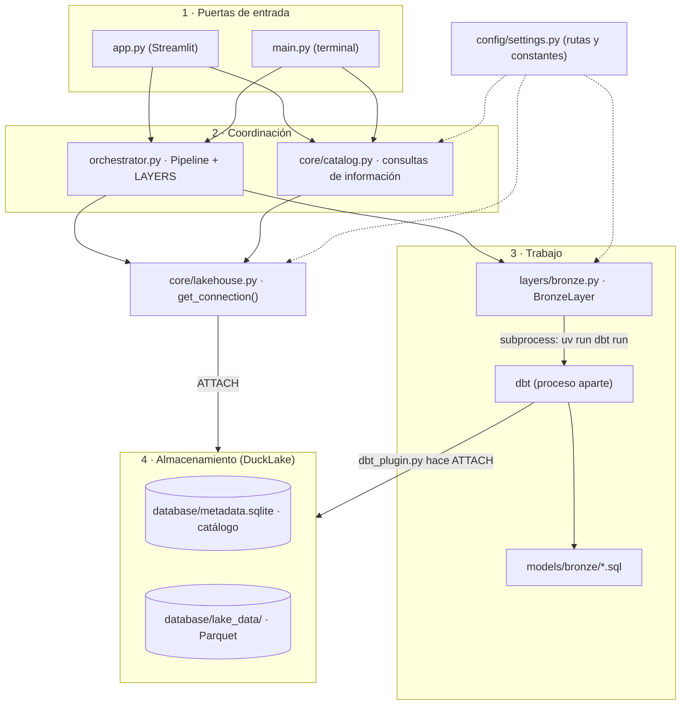
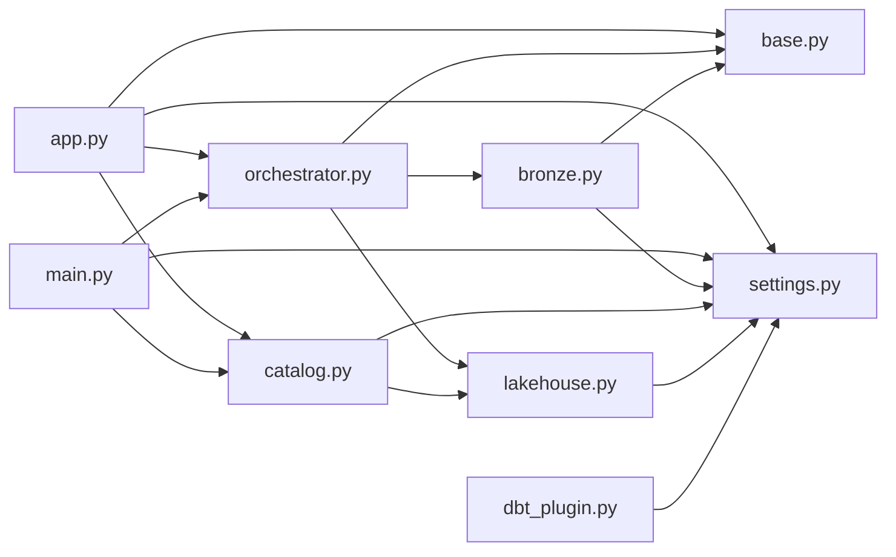
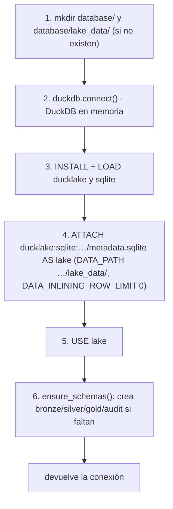
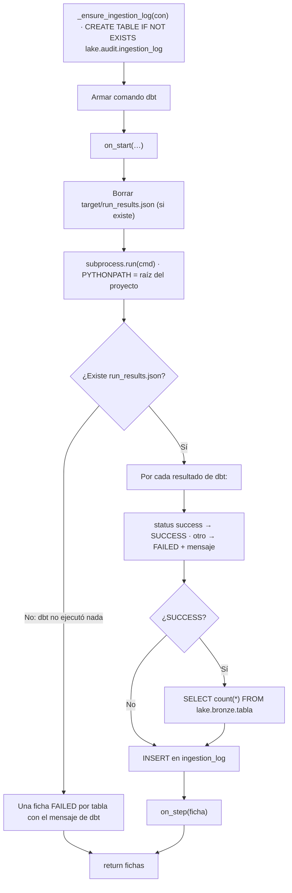
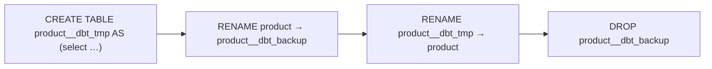
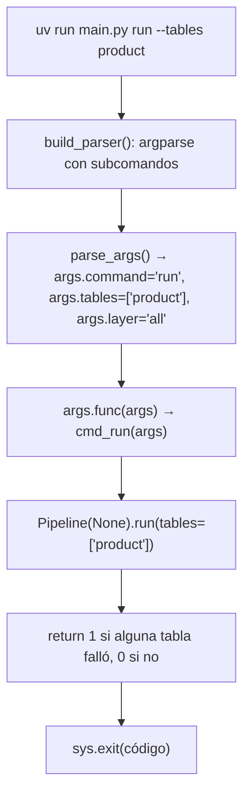
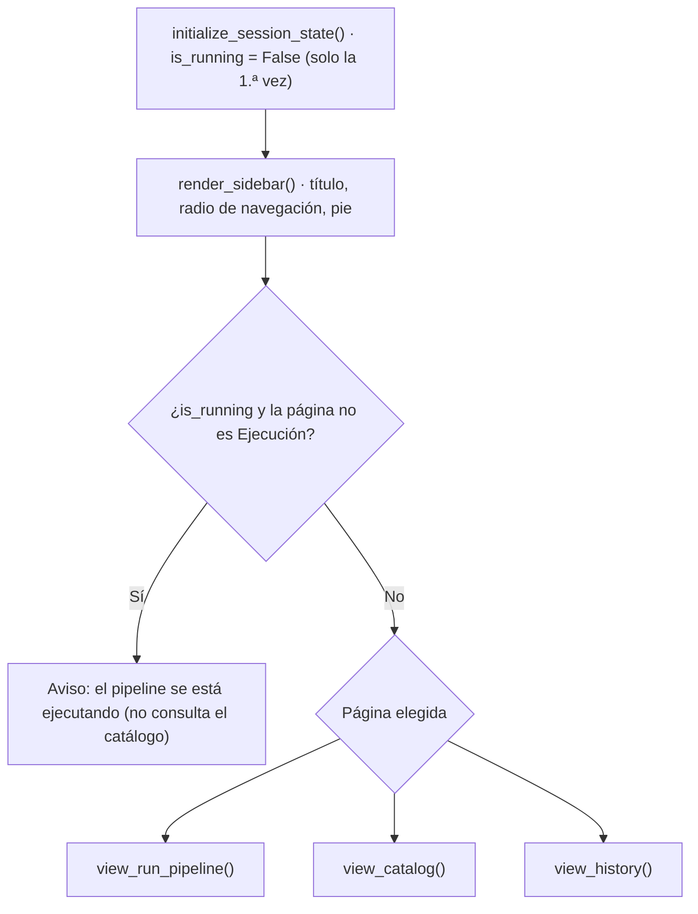
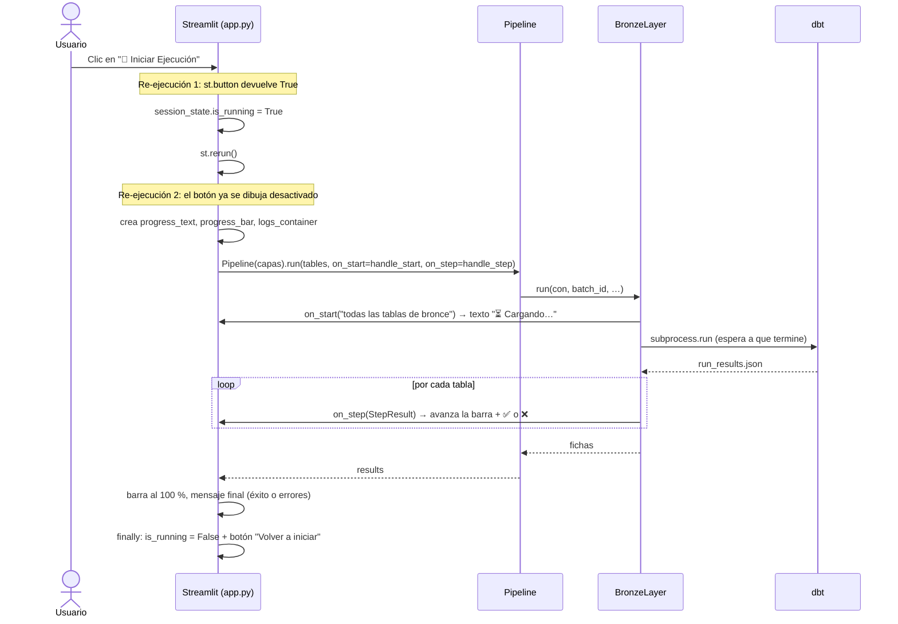

# 📘 Guía del código: cómo funciona el lakehouse por dentro

> Documento de estudio para entender **exactamente** qué hace cada archivo, con qué lógica y en qué
> orden se ejecuta. Complementa al [`README.md`](README.md) (qué es y cómo se usa) y a
> [`SETUP.md`](SETUP.md) (cómo se instala). Las referencias del tipo `archivo.py:123` indican el
> número de línea aproximado donde empieza cada pieza.

---

## Índice

1. [Cómo leer esta guía](#1-cómo-leer-esta-guía)
2. [Vista de pájaro: las piezas y cómo se conectan](#2-vista-de-pájaro-las-piezas-y-cómo-se-conectan)
3. [Configuración central — `pipeline/config/settings.py`](#3-configuración-central--pipelineconfigsettingspy)
4. [La conexión al lakehouse — `pipeline/core/lakehouse.py`](#4-la-conexión-al-lakehouse--pipelinecorelakehousepy)
5. [El contrato de las capas — `pipeline/core/base.py`](#5-el-contrato-de-las-capas--pipelinecorebasepy)
6. [El orquestador — `pipeline/orchestrator.py`](#6-el-orquestador--pipelineorchestratorpy)
7. [La capa bronce — `pipeline/layers/bronze.py`](#7-la-capa-bronce--pipelinelayersbronzepy)
8. [dbt por dentro](#8-dbt-por-dentro)
9. [DuckLake por dentro: qué queda en disco](#9-ducklake-por-dentro-qué-queda-en-disco)
10. [Las consultas de información — `pipeline/core/catalog.py`](#10-las-consultas-de-información--pipelinecorecatalogpy)
11. [La terminal — `main.py`](#11-la-terminal--mainpy)
12. [La aplicación web — `app.py`](#12-la-aplicación-web--apppy)
13. [Recorridos completos, paso a paso](#13-recorridos-completos-paso-a-paso)
14. [Archivos que se generan](#14-archivos-que-se-generan)
15. [Detalles finos y limitaciones conocidas](#15-detalles-finos-y-limitaciones-conocidas)
16. [Glosario técnico](#16-glosario-técnico)
17. [Preguntas para comprobar tu comprensión](#17-preguntas-para-comprobar-tu-comprensión)

---

## 1. Cómo leer esta guía

**Orden de lectura sugerido**, de lo más básico a lo más complejo. Es el mismo orden en que las
piezas dependen unas de otras:

```
settings.py → lakehouse.py → base.py → orchestrator.py → bronze.py → dbt (models/, dbt_plugin.py)
            → catalog.py → main.py → app.py
```

Ten abiertos los archivos mientras lees: cada sección explica **qué hace**, **por qué** y **cómo
se conecta** con lo demás. Todos los archivos de `pipeline/` además tienen comentarios en español
línea por línea.

---

## 2. Vista de pájaro: las piezas y cómo se conectan

El código se organiza en **cuatro niveles**: las puertas de entrada (lo que el usuario usa), la
coordinación, el trabajo de las capas y el almacenamiento.



**Idea clave:** hay **dos procesos** que escriben en el lakehouse:

1. **El proceso de Python** de la app o de la terminal. Abre su conexión con `get_connection()`,
   crea la bitácora y escribe en ella.
2. **El proceso de dbt**, lanzado por la capa bronce como un programa aparte. Abre **su propia**
   conexión mediante `dbt_plugin.py` y crea las tablas de bronce.

Ambos apuntan al mismo catálogo SQLite y a la misma carpeta de Parquet, con las mismas opciones.

### ¿Quién importa a quién?



`settings.py` no importa nada del proyecto: es la base de todo.

---

## 3. Configuración central — `pipeline/config/settings.py`

**Propósito:** reunir en un solo lugar **dónde** están las cosas, **cómo** se llama el lakehouse y
**qué** fuentes existen. Ningún otro archivo escribe rutas "a mano".

### 3.1 Rutas (`settings.py:59`)

```python
PROJECT_ROOT = Path(__file__).resolve().parents[2]
```

- `__file__` es la ruta de `settings.py` mismo: `<raíz>/pipeline/config/settings.py`.
- `.resolve()` la convierte en ruta absoluta.
- `.parents[0]` es `config/`, `.parents[1]` es `pipeline/` y `.parents[2]` es **la raíz del proyecto**.

Así el proyecto funciona en cualquier carpeta y en cualquier computador, sin rutas fijas. De ahí
salen las demás:

| Constante | Valor | Uso |
|---|---|---|
| `DATA_DIR` | `<raíz>/data` | CSV de origen |
| `DATABASE_DIR` | `<raíz>/database` | Todo el lakehouse |
| `CATALOG_PATH` | `<raíz>/database/metadata.sqlite` | Catálogo SQLite de DuckLake |
| `LAKE_DATA_PATH` | `<raíz>/database/lake_data` | Archivos Parquet del lakehouse |
| `POWERBI_EXPORT_PATH` | `<raíz>/database/powerbi_gold` | Parquet limpios de la capa `gold` listos para Power BI |

### 3.2 Parámetros de DuckLake

| Constante | Valor | Significado |
|---|---|---|
| `CATALOG_NAME` | `"lake"` | Nombre con que se "monta" el lakehouse en SQL: `lake.bronze.product` |
| `DATA_INLINING_ROW_LIMIT` | `0` | Desactiva el *inlining*: ninguna fila se guarda dentro de SQLite, todo va a Parquet |
| `SCHEMA_BRONZE/SILVER/GOLD/AUDIT` | `"bronze"`, … | Nombres de los esquemas |
| `SCHEMAS` | tupla con los cuatro | Lista que `ensure_schemas()` crea si faltan |
| `COMMIT_AUTHOR` | `"medallion-pipeline"` | Autor de versiones, usado por `set_commit_message()` (hoy sin uso, ver §15) |

### 3.3 Registro de fuentes: `SourceTable` y `SOURCES` (`settings.py:120`)

```python
@dataclass(frozen=True)
class SourceTable:
    file_name: str
    table_name: str
    description: str = ""
    read_options: dict[str, object] = field(default_factory=dict)

    @property
    def path(self) -> Path:
        return DATA_DIR / self.file_name
```

- `@dataclass` genera automáticamente el constructor; `frozen=True` impide modificar los campos
  una vez creados.
- `field(default_factory=dict)` evita un error clásico de Python: compartir el mismo diccionario
  entre todas las instancias.
- `path` es una **propiedad calculada**: se usa como atributo (`fuente.path`), pero se calcula al vuelo.

`SOURCES` es una tupla con las 8 fuentes. **Ojo:** desde que la carga la hace dbt, esta lista
**no define qué se carga** (eso lo hacen `models/sources.yml` y `models/bronze/*.sql`). Hoy se usa
en dos lugares:

1. `app.py`, para saber cuántas tablas esperar y calcular el avance de la barra de progreso.
2. `bronze.py`, para saber qué tablas marcar como fallidas si dbt no alcanza a ejecutar nada.

---

## 4. La conexión al lakehouse — `pipeline/core/lakehouse.py`

**Propósito:** entregar una conexión de DuckDB **lista para usar**, con el lakehouse montado.

### 4.1 `get_connection()` (`lakehouse.py:49`), paso a paso



Detalles importantes:

- **DuckDB en memoria** (`duckdb.connect()` sin archivo): la sesión de DuckDB es temporal, pero los
  datos **no** viven en ella sino en el lakehouse adjunto. Cerrar la conexión no borra nada.
- **`INSTALL`** descarga la extensión solo la primera vez (necesita internet). **`LOAD`** la activa
  en esta sesión.
- **`ATTACH 'ducklake:sqlite:<ruta>'`**: el prefijo `ducklake:` dice "esto es un lakehouse DuckLake"
  y `sqlite:` dice "su catálogo es un archivo SQLite". Si el archivo no existe, DuckLake lo crea.
- **`_sql_str()`** (`lakehouse.py:36`) envuelve las rutas entre comillas simples y duplica las
  comillas internas, para que una carpeta como `O'Brien` no rompa el SQL.
- **`USE lake`** convierte a `lake` en la base por defecto: por eso se puede escribir
  `bronze.product` en lugar de `lake.bronze.product`.

### 4.2 `ensure_schemas()` (`lakehouse.py:112`)

Consulta `information_schema.schemata` para ver qué esquemas existen y crea solo los que faltan.
Es **idempotente**: se puede ejecutar muchas veces sin error ni efectos repetidos.

### 4.3 `set_commit_message()` (`lakehouse.py:137`)

Llama a `CALL lake.set_commit_message(autor, mensaje, extra_info => …)` para etiquetar la versión
que se está creando. Solo funciona **dentro de una transacción** (`BEGIN … COMMIT`).
**Hoy no se usa** (ver §15).

### 4.4 ¿Quién llama a `get_connection()`?

- El **orquestador**: abre una conexión para toda la corrida.
- Cada función de **`catalog.py`**: abre y cierra una conexión por consulta.

`dbt_plugin.py` **no** la usa: replica el mismo `ATTACH` dentro del proceso de dbt (§8.2).

---

## 5. El contrato de las capas — `pipeline/core/base.py`

**Propósito:** definir las piezas comunes para que el orquestador trate a todas las capas igual.

### 5.1 Configuración de mensajes (logging)

```python
logging.basicConfig(level=logging.INFO,
                    format="%(asctime)s | %(levelname)-7s | %(name)s | %(message)s",
                    datefmt="%H:%M:%S")
```

Se ejecuta **una sola vez, al importar** `base.py`. Desde ese momento, cualquier mensaje del
proyecto se ve así:

```
18:30:01 | INFO    | pipeline.bronze | Iniciando capa bronce mediante dbt | batch=…
```

`get_logger(nombre)` devuelve un "narrador" con nombre propio: `pipeline` para el orquestador y
`pipeline.bronze` para la capa bronce.

### 5.2 `StepResult` (`base.py:71`)

Una ficha (dataclass) con el resultado de **una tabla**:

| Campo | Tipo | Ejemplo |
|---|---|---|
| `layer` | str | `"bronze"` |
| `table` | str | `"product"` |
| `status` | str | `"SUCCESS"`, `"FAILED"` o `"SKIPPED"` |
| `rows` | int | `92353` |
| `seconds` | float | `0.21` |
| `error` | str o None | mensaje de error |

Es el **idioma común** entre las capas, el orquestador, la terminal y la app.

### 5.3 `Layer` (`base.py:95`): una clase abstracta

```python
class Layer(ABC):
    name: str = "layer"
    def __init__(self):
        self.log = get_logger(f"pipeline.{self.name}")

    @abstractmethod
    def run(self, con, batch_id, tables=None, on_start=None, on_step=None) -> list[StepResult]: ...
```

- `ABC` + `@abstractmethod` hacen que **no se pueda crear** una capa que no implemente `run`. Python
  lanza un error si se intenta.
- **Parámetros de `run`:**
  - `con`: la conexión abierta por el orquestador.
  - `batch_id`: el identificador de la corrida.
  - `tables`: un filtro opcional de tablas.
  - `on_start` y `on_step`: **callbacks**, es decir, funciones que la capa "llama de vuelta" para
    avisar cómo va.

> 💡 **¿Por qué callbacks?** Para que el pipeline **no dependa de Streamlit**. La capa solo sabe
> "cuando termine una tabla, llamo a `on_step(resultado)`". La app le pasa una función que pinta en
> pantalla y la terminal no le pasa nada. El mismo código sirve para ambas.

---

## 6. El orquestador — `pipeline/orchestrator.py`

**Propósito:** decidir **qué capas** se ejecutan, **en qué orden**, y garantizar que la conexión se
cierre pase lo que pase.

### 6.1 El registro `LAYERS` (`orchestrator.py:47`)

```python
LAYERS: dict[str, type[Layer]] = {
    "bronze": BronzeLayer,
    # "silver": SilverLayer,  # pendiente
    # "gold": GoldLayer,      # pendiente
}
```

Es un diccionario `nombre → clase` (la clase, no un objeto). **El orden de las llaves es el orden
de ejecución.** La app y la terminal leen este diccionario para mostrar las opciones de capa, así
que una capa nueva aparece en la interfaz con solo registrarla aquí.

### 6.2 `new_batch_id()` (`orchestrator.py:57`)

```python
return f"{datetime.now():%Y%m%dT%H%M%S}-{uuid.uuid4().hex[:6]}"
# ej.: 20261014T183000-a1b2c3
```

La fecha lo hace legible y ordenable; los 6 caracteres aleatorios evitan choques si hay dos corridas
en el mismo segundo.

### 6.3 `Pipeline.__init__` (`orchestrator.py:78`)

1. Si no se piden capas, usa **todas** las del registro.
2. Valida los nombres: si alguno no existe, lanza `ValueError` con las opciones válidas.
3. Crea las capas **en el orden del registro**, no en el pedido:
   `[LAYERS[n]() for n in LAYERS if n in names]`. Así, aunque se pida `gold, bronze`, siempre corre
   primero bronce.

### 6.4 `Pipeline.run()` (`orchestrator.py:99`)

```python
batch_id = new_batch_id()
con = get_connection()
try:
    for layer in self.layers:
        results.extend(layer.run(con, batch_id, tables, on_start=on_start, on_step=on_step))
finally:
    con.close()
self._summary(results, tiempo_total)
return results
```

- Genera **un solo** `batch_id` para toda la corrida: todas las capas y tablas lo comparten.
- `try/finally` garantiza que la conexión se cierre **aunque** una capa lance una excepción.
- `_summary()` imprime en el log una tabla alineada con el resultado de cada tabla y el total de fallas.
- Devuelve la lista de `StepResult` a quien lo llamó: la app o `main.py`.

---

## 7. La capa bronce — `pipeline/layers/bronze.py`

**Propósito:** cargar los CSV al esquema `bronze`. Desde la migración a dbt, la clase **no escribe
SQL de carga**: es un **puente** que ejecuta dbt, interpreta su resultado y lo anota en la bitácora.

### 7.1 Flujo completo de `BronzeLayer.run()` (`bronze.py:75`)



### 7.2 El comando dbt

```python
selection = tables if tables else ["bronze"]
cmd = ["uv", "run", "dbt", "run",
       "--select", *selection,
       "--profiles-dir", ".",
       "--vars", json.dumps({"batch_id": batch_id})]
```

| Parte | Qué significa |
|---|---|
| `uv run dbt run` | Ejecuta dbt con las librerías del entorno del proyecto |
| `--select bronze` | Ejecuta todos los modelos de la carpeta `models/bronze/` |
| `--select product coupon` | Ejecuta solo esos modelos (se llaman igual que la tabla) |
| `--profiles-dir .` | Busca `profiles.yml` en la raíz del proyecto (por defecto dbt lo busca en `~/.dbt/`) |
| `--vars {"batch_id": "…"}` | Le pasa a dbt el `batch_id` del orquestador, para que quede en la columna `_batch_id` |

`subprocess.run(..., capture_output=True, text=True, cwd=PROJECT_ROOT, env=env)`:
- `cwd=PROJECT_ROOT`: dbt corre desde la raíz. Por eso las rutas relativas `data/…csv` de
  `sources.yml` funcionan.
- `env["PYTHONPATH"] = PROJECT_ROOT`: permite que dbt importe `dbt_plugin.py`, que a su vez importa
  `pipeline.config.settings`.
- `capture_output=True`: la salida de dbt no se ve en pantalla; se guarda y solo se imprime en el
  log si dbt falla.
- **Es bloqueante:** Python espera a que dbt termine **todas** las tablas antes de seguir.

### 7.3 ¿Por qué borrar `run_results.json` antes?

dbt escribe ese archivo al **terminar**. Si dbt fallara al arrancar (por un error de configuración,
por ejemplo), el archivo viejo seguiría ahí y se registrarían resultados de una corrida anterior como
si fueran nuevos. Al borrarlo antes, "no existe" significa con certeza "esta corrida no produjo resultados".

### 7.4 Cómo se interpreta `run_results.json`

Cada elemento de `results` tiene, entre otros:

```json
{"unique_id": "model.lakehouse_dbt.product", "status": "success",
 "execution_time": 0.21, "message": "OK", "adapter_response": {...}}
```

- **Tabla:** la última parte de `unique_id`, en este caso `product`.
- **Estado:** `success` → `SUCCESS`; cualquier otro valor (`error`, `skipped`) → `FAILED`.
- **Filas:** como dbt-duckdb no siempre informa filas afectadas, se cuentan con
  `SELECT count(*)` usando la conexión del orquestador.

### 7.5 La bitácora `lake.audit.ingestion_log`

| Columna | Tipo | Contenido |
|---|---|---|
| `batch_id` | VARCHAR | Identificador de la corrida |
| `layer` | VARCHAR | `bronze` |
| `table_name` | VARCHAR | Tabla cargada |
| `source_file` | VARCHAR | `<tabla>.csv` |
| `rows_loaded` | BIGINT | Filas |
| `duration_sec` | DOUBLE | Segundos que reportó dbt |
| `status` | VARCHAR | `SUCCESS` / `FAILED` |
| `error_message` | VARCHAR | Error, si lo hubo |
| `logged_at` | TIMESTAMPTZ | Momento del registro |

Los `INSERT` usan parámetros `?`, de modo que DuckDB inserta los valores de forma segura.

---

## 8. dbt por dentro

dbt es un programa que toma **archivos SQL con plantillas** (Jinja), los **compila** a SQL puro y
los **ejecuta** en la base de datos, respetando dependencias. Estos son los archivos que lo configuran.

### 8.1 `profiles.yml`: a qué base se conecta dbt

```yaml
lakehouse:
  target: dev
  outputs:
    dev:
      type: duckdb
      path: ':memory:'
      plugins:
        - module: dbt_plugin
```

dbt abre un DuckDB **en memoria** (esquema por defecto `main`) y carga el plugin `dbt_plugin`.

### 8.2 `dbt_plugin.py`: monta el lakehouse dentro de dbt

```python
class Plugin(BasePlugin):
    def configure_connection(self, conn):
        # INSTALL/LOAD ducklake y sqlite
        # ATTACH 'ducklake:sqlite:<CATALOG_PATH>' AS lake (DATA_PATH '<LAKE_DATA_PATH>/', DATA_INLINING_ROW_LIMIT 0)
```

dbt-duckdb llama a `configure_connection` **cada vez que abre una conexión**. El plugin hace el mismo
`ATTACH` que `get_connection()`, tomando las rutas de `settings.py`, para que el pipeline y dbt vean
**exactamente el mismo lakehouse** con las mismas opciones.

### 8.3 `dbt_project.yml`: el proyecto

- `name: 'lakehouse_dbt'`: por eso los modelos se llaman `model.lakehouse_dbt.<nombre>`.
- `profile: 'lakehouse'`: usa el perfil de `profiles.yml`.
- `model-paths: ["models"]`, `macro-paths: ["macros"]`.
- `models: lakehouse_dbt: bronze: +materialized: table`: todo lo de `models/bronze/` se crea como
  **tabla física**, no como vista.

### 8.4 `models/sources.yml`: de dónde salen los datos

```yaml
sources:
  - name: lake_data
    tables:
      - name: product
        meta:
          external_location: "read_csv_auto('data/product.csv', all_varchar=true)"
```

Es una característica de **dbt-duckdb**: si una fuente tiene `external_location`, al escribir
`{{ source('lake_data', 'product') }}` dbt pone **esa expresión** en el SQL, en lugar del nombre de
una tabla.
- `read_csv_auto` detecta el separador y los encabezados del CSV.
- `all_varchar=true` fuerza **todas** las columnas a texto: es la regla de "fidelidad al origen".

### 8.5 Un modelo: `models/bronze/product.sql`

**Lo que está escrito (plantilla):**

```sql
{{ config(materialized='table', database='lake', schema='bronze') }}
select
    *,
    '{{ var("batch_id", invocation_id) }}' as _batch_id,
    'product.csv' as _source_file,
    current_timestamp as _ingested_at
from {{ source('lake_data', 'product') }}
```

**Lo que dbt ejecuta (compilado)** — puedes verlo en `target/compiled/…/product.sql`:

```sql
select
    *,
    '20261014T183000-a1b2c3' as _batch_id,
    'product.csv' as _source_file,
    current_timestamp as _ingested_at
from read_csv_auto('data/product.csv', all_varchar=true)
```

- `config(database='lake', schema='bronze')`: el resultado se guarda en `lake.bronze.product`.
- `var("batch_id", invocation_id)`: usa el valor de `--vars`; si dbt se ejecuta a mano sin `--vars`,
  usa el identificador propio de la invocación de dbt.
- El nombre del archivo (`product`) es el nombre del modelo y de la tabla.

### 8.6 `macros/duckdb_overrides.sql`: dos ajustes para DuckLake

1. **`generate_schema_name`**: por defecto dbt **concatena** el esquema del perfil con el del modelo
   y produciría `main_bronze`. Este macro hace que use el esquema del modelo tal cual (`bronze`).
   En el catálogo todavía queda rastro de un esquema `main_bronze` de cuando aún no existía el macro.
2. **`duckdb__drop_relation`**: redefine cómo dbt borra tablas, con un `drop … if exists` simple,
   sin las opciones adicionales del macro original que DuckLake no acepta.

### 8.7 Cómo dbt materializa una tabla (y por qué hay carpetas `__dbt_tmp`)

Para no dejar nunca una tabla a medio cargar, dbt sigue estos pasos con cada modelo `table`:



Si el paso A falla, la tabla original queda intacta. Por eso los Parquet viven en carpetas como
`lake_data/bronze/product__dbt_tmp/`: DuckLake renombra la tabla **en el catálogo** pero no mueve los
archivos. Es normal.

### 8.8 La carpeta `target/`

| Archivo | Para qué sirve |
|---|---|
| `run_results.json` | Resultado de cada modelo en la última corrida; lo lee `bronze.py` |
| `manifest.json` | Descripción completa del proyecto: modelos, fuentes, dependencias |
| `compiled/…` | El SQL ya compilado (sin Jinja); muy útil para depurar |
| `run/…` | El SQL tal como se ejecutó, incluido el `create table` |
| `partial_parse.msgpack` | Caché para que dbt arranque más rápido |

---

## 9. DuckLake por dentro: qué queda en disco

### 9.1 Una escritura = una versión (snapshot)

Cada transacción que modifica el lakehouse crea un **snapshot** nuevo. Una corrida de bronce genera
**muchos**: por cada tabla, el `CREATE`, los `RENAME` y el `DROP` de dbt; y por cada fila de la
bitácora, un `INSERT`. Por eso el catálogo ya tiene cientos de versiones.

### 9.2 Muchos archivos Parquet pequeños en `audit/ingestion_log/`

Como el *inlining* está desactivado, **cada `INSERT` de una fila en la bitácora genera un archivo
Parquet de una sola fila**. Es inofensivo, y `CALL ducklake_merge_adjacent_files('lake')` los compacta.

### 9.3 Cómo funciona el *time travel*

En SQLite, la tabla `ducklake_data_file` guarda, para cada Parquet, `begin_snapshot` y `end_snapshot`.
Una consulta como:

```sql
SELECT * FROM lake.bronze.product AT (VERSION => 8)
```

hace que DuckLake busque en SQLite los archivos vigentes en la versión 8 (`begin ≤ 8 < end`) y lea
solo esos. Los Parquet viejos **no se borran** al recargar: por eso el *time travel* funciona y por
eso la carpeta crece (ver la limpieza en el anexo del README).

---

## 10. Las consultas de información — `pipeline/core/catalog.py`

**Propósito:** un solo lugar con las consultas de "solo lectura" que usan tanto `main.py` como
`app.py`. Todas devuelven un **DataFrame de pandas** y abren su propia conexión con
`with get_connection() as con:`. El `with` cierra la conexión al terminar.

| Función | SQL de fondo | Lo usa |
|---|---|---|
| `list_tables()` | `duckdb_tables()` (filas estimadas) **LEFT JOIN** `ducklake_table_info('lake')` (archivos y tamaño), filtrado a `database_name = 'lake'` | Explorador, `main.py info` |
| `list_snapshots(limit)` | `ducklake_snapshots('lake')` ordenado de la versión más nueva a la más vieja | Explorador (selector de versión), Historial, `main.py info` |
| `ingestion_log(limit)` | `SELECT … FROM lake.audit.ingestion_log ORDER BY logged_at DESC`. Si la tabla no existe, devuelve un DataFrame vacío | Historial |
| `table_columns(schema, table)` | `information_schema.columns` filtrado por catálogo, esquema y tabla | Explorador |
| `preview_table(schema, table, version, limit)` | `SELECT * FROM lake.<esq>.<tabla> [AT (VERSION => n)] LIMIT n` | Explorador |
| `export_gold_to_powerbi()` | Consulta `information_schema.tables` para `lake.gold` y ejecuta `COPY (SELECT * FROM lake.gold.<tabla>) TO '…/powerbi_gold/<tabla>.parquet'` | Ejecución (sección Power BI) |
| `build_powerbi_gold_zip()` | Empaqueta en memoria todos los `.parquet` de `database/powerbi_gold/` en un archivo `.zip` | Ejecución (botón de descarga ZIP) |
| `powerbi_m_script()` | Genera el script Power Query (M) con `Folder.Files` y `Parquet.Document` apuntando a `POWERBI_EXPORT_PATH` | Ejecución (desplegable Power Query) |

Las columnas se renombran en el SQL (`AS Esquema`, `AS "Tamaño (MB)"`…) para que lleguen a la
pantalla con nombres en español.

---

## 11. La terminal — `main.py`

**Propósito:** ofrecer dos comandos: `run` e `info`.



- **`build_parser()`** (`main.py:96`) define los subcomandos. `--layer` solo acepta `all` o una
  capa de `LAYERS`, gracias a `choices`. `--tables` acepta varios valores, gracias a `nargs="+"`.
  `set_defaults(func=…)` asocia cada subcomando con su función.
- **`cmd_run`** traduce `all` a `None` ("todas las capas") y devuelve un **código de salida**: `0`
  significa éxito y `1` que hubo fallas. Sirve para automatizar, por ejemplo con un programador de tareas.
- **`cmd_info`** imprime las rutas, `list_tables()` y las últimas 15 versiones con `list_snapshots(15)`.
- `if __name__ == "__main__":` hace que `main()` solo se ejecute cuando el archivo se corre
  directamente, no cuando se importa.

---

## 12. La aplicación web — `app.py`

### 12.1 El modelo mental de Streamlit (lo más importante)

Streamlit **vuelve a ejecutar todo el archivo `app.py` de arriba abajo** cada vez que el usuario
interactúa: un clic, elegir una opción, escribir. No hay "eventos" como en otras tecnologías web:
cada interacción es una **re-ejecución completa**.

Consecuencias:
- Las variables normales **se pierden** entre re-ejecuciones. Para recordar algo hay que guardarlo en
  **`st.session_state`**, un diccionario que sobrevive mientras la pestaña del navegador esté abierta.
- `st.button(...)` devuelve `True` **solo** en la re-ejecución causada por ese clic.
- `st.rerun()` fuerza una re-ejecución inmediata.

### 12.2 Arranque: `main()` (`app.py:278`)



`st.set_page_config(...)` (título de la pestaña del navegador, ícono y diseño ancho) se ejecuta al
inicio del archivo. Los colores salen de `.streamlit/config.toml`.

### 12.3 Pestaña Ejecución: `view_run_pipeline()` (`app.py:67`)

Es la parte más delicada, porque usa **dos re-ejecuciones**:



Puntos clave:
- **¿Por qué el `st.rerun()` intermedio?** Para que el botón se vea **desactivado**
  (`disabled=st.session_state.is_running`) antes de empezar el trabajo largo y no se pueda pulsar dos veces.
- **Callbacks como clausuras:** `handle_start` y `handle_step` se definen **dentro** de la función,
  así que "ven" `progress_bar`, `logs_container` y `state`. Se usa el diccionario `state = {"progress": 0}`
  porque una función interna puede modificar el contenido de un diccionario externo sin declarar
  `nonlocal`.
- **Avance de la barra:** `step_size = 90 // número_de_tablas_esperadas`, con un tope de 90 %. El
  100 % se marca al terminar.
- **`try/except/finally`:** `except` muestra errores graves, por ejemplo una capa inexistente.
  `finally` **siempre** libera el candado `is_running`.
- **Sección Power BI (`render_powerbi_section`):** debajo del botón de ejecución se muestra la tarjeta
  **📊 Conectar capa Gold a Power BI**. Al pulsar el botón, llama a `catalog.export_gold_to_powerbi()`,
  guarda el DataFrame resultante en `st.session_state.powerbi_export_df` (para que no desaparezca al
  hacer clic en `st.download_button`) y presenta la ruta local `database/powerbi_gold`, el botón para
  descargar `powerbi_gold_parquet.zip` y el script Power Query (M).

### 12.4 Pestaña Explorador: `view_catalog()` (`app.py:165`)

1. `catalog.list_tables()`. Si falla, muestra un error; si está vacía, invita a ejecutar el pipeline.
2. Muestra la tabla resumen con `st.dataframe`.
3. Dos selectores dependientes: **Esquema** (valores únicos) y **Tabla** (filtrada por ese esquema).
4. Selector de **versión**: arma opciones `"<versión> - <mensaje> (<fecha>)"` desde `list_snapshots()`.
   Si se elige una, extrae el número con `split(" - ")[0]`.
5. Al pulsar **Cargar vista previa**: `table_columns()` muestra la estructura y
   `preview_table(..., version=…, limit=50)` muestra la muestra. Si se elige una versión en la que la
   tabla aún no existía, DuckDB lanza un error y la app lo muestra.

### 12.5 Pestaña Historial: `view_history()` (`app.py:232`)

Dos sub-pestañas (`st.tabs`):
- **Bitácora de cargas:** `catalog.ingestion_log()`. Formatea la fecha con pandas y colorea la
  columna `Estado` con `df.style.map(color_status, subset=['Estado'])`: verde para `SUCCESS` y rojo
  para lo demás.
- **Versiones del lakehouse:** `catalog.list_snapshots()` con la fecha formateada.

### 12.6 ¿Por qué el aviso de "no navegues"?

Por dos motivos:
1. **SQLite admite un solo escritor:** mientras dbt escribe, otra conexión que intente escribir
   (o, en algunos momentos, leer) puede recibir `database is locked`.
2. **Comportamiento de Streamlit:** si el usuario interactúa durante una ejecución, Streamlit
   **interrumpe** la ejecución en curso para volver a dibujar la página. dbt, al ser un proceso aparte,
   termina igual, pero la app podría no alcanzar a mostrar o registrar todos los resultados.

---

## 13. Recorridos completos, paso a paso

### 13.1 `uv run main.py run --tables product`

| # | Dónde | Qué pasa |
|---|---|---|
| 1 | `main.py` | argparse produce `command='run'`, `layer='all'`, `tables=['product']` → `cmd_run` |
| 2 | `orchestrator.py` | `Pipeline(None)` → capas `[BronzeLayer()]` |
| 3 | `orchestrator.py` | `batch_id = "20261014T183000-a1b2c3"`; `get_connection()` monta `lake` |
| 4 | `bronze.py` | `CREATE TABLE IF NOT EXISTS lake.audit.ingestion_log` |
| 5 | `bronze.py` | Borra `target/run_results.json`; lanza `uv run dbt run --select product --profiles-dir . --vars {"batch_id": "…"}` |
| 6 | dbt | Lee `profiles.yml` → DuckDB en memoria → `dbt_plugin` hace `ATTACH` del lakehouse |
| 7 | dbt | Compila `product.sql`: `source()` → `read_csv_auto('data/product.csv', all_varchar=true)`; `var()` → el batch_id |
| 8 | dbt | `CREATE TABLE lake.bronze.product__dbt_tmp AS …` → renombra → borra el respaldo |
| 9 | DuckLake | Escribe Parquet en `lake_data/bronze/product__dbt_tmp/` y registra archivos y versiones en SQLite |
| 10 | dbt | Escribe `target/run_results.json` y termina |
| 11 | `bronze.py` | Lee el resultado: `success` → `SELECT count(*)` → 92.353 filas |
| 12 | `bronze.py` | `INSERT` en `ingestion_log` (otro snapshot, otro Parquet pequeño) |
| 13 | `orchestrator.py` | Cierra la conexión e imprime el resumen |
| 14 | `main.py` | `sys.exit(0)` |

### 13.2 Explorador → ver `product` en una versión anterior

1. Abrir la pestaña Explorador hace que Streamlit re-ejecute `app.py` y `main()` llame a
   `view_catalog()`.
2. `list_tables()` abre una conexión (con `ATTACH`), consulta y la cierra.
3. Se eligen el esquema `bronze`, la tabla `product` y una versión, por ejemplo `120 - … (fecha)`.
4. Con **Cargar vista previa**, `table_columns()` y luego
   `preview_table('bronze', 'product', version=120, limit=50)` ejecutan
   `SELECT * FROM lake.bronze.product AT (VERSION => 120) LIMIT 50`.
5. DuckLake consulta en SQLite qué Parquet estaban vigentes en la versión 120 y lee solo esos.

### 13.3 ¿Qué pasa si falta un CSV?

1. dbt intenta ejecutar `read_csv_auto('data/coupon.csv', …)` y DuckDB falla porque el archivo no existe.
2. Ese modelo queda con `status: error` en `run_results.json`; **los demás modelos se ejecutan igual**.
3. `bronze.py` crea una ficha `FAILED` con el mensaje de dbt y la anota en la bitácora.
4. La app muestra `❌ bronze.coupon falló: …` y, al final, "El pipeline terminó con errores".
   `main.py` termina con código `1`.

---

## 14. Archivos que se generan

| Ruta | Quién la crea | Contenido |
|---|---|---|
| `database/metadata.sqlite` | DuckLake, en el primer `ATTACH` | Catálogo (metadatos, versiones, estadísticas) |
| `database/lake_data/<esquema>/<tabla>/*.parquet` | DuckLake, al escribir | Datos (incluye versiones históricas y carpetas `__dbt_tmp`) |
| `database/powerbi_gold/<tabla>.parquet` | `catalog.export_gold_to_powerbi()`, desde la app | Un archivo Parquet limpio por tabla de la capa `gold` (solo versión vigente) para Power BI |
| `target/` | dbt | SQL compilado, `run_results.json`, `manifest.json` |
| `logs/dbt.log` | dbt | Registro detallado de cada ejecución de dbt |
| `.venv/` | `uv sync` | Entorno de Python con las librerías |
| `__pycache__/` | Python | Código precompilado para arrancar más rápido |

---

## 15. Detalles finos y limitaciones conocidas

Conocerlas ayuda a entender el código y son buenos temas de discusión:

1. **Las versiones no tienen mensaje ni autor.** `set_commit_message()` existe pero no se llama: la
   carga la hace dbt en otro proceso, y el mensaje debe fijarse dentro de su misma transacción.
2. **Dos procesos con el mismo catálogo.** El orquestador mantiene su conexión abierta mientras dbt
   escribe. Funciona porque cada uno escribe en momentos distintos, pero SQLite solo admite un
   escritor a la vez.
3. **El progreso no es "en vivo" por tabla.** dbt procesa todas las tablas y **después** la app
   recibe los resultados; por eso la barra avanza de golpe al final.
4. **Doble registro de fuentes.** Las tablas se declaran en `models/sources.yml` y
   `models/bronze/*.sql` (lo que de verdad se carga) **y** en `settings.SOURCES` (lo que usan la app
   y el manejo de errores). Hay que mantenerlos sincronizados.
5. **SQL armado con f-strings** en `catalog.py` (nombres de esquema y tabla). Es aceptable aquí porque
   los valores vienen de listas cerradas de la propia app; en un sistema expuesto a usuarios externos
   habría que validarlos.
6. **Archivos pequeños y versiones que se acumulan.** Cada fila de la bitácora es un Parquet y cada
   recarga conserva los Parquet antiguos. Hay que hacer mantenimiento periódico (anexo del README).
7. **`pandas` no está declarado** en `pyproject.toml`: llega como dependencia de Streamlit.
8. **Primera ejecución con internet.** `INSTALL ducklake/sqlite` descarga las extensiones la primera vez.

---

## 16. Glosario técnico

| Término | Significado en este proyecto |
|---|---|
| **ATTACH** | Instrucción de DuckDB que "monta" otra base (aquí, el lakehouse) dentro de la sesión |
| **Callback** | Función que se entrega a otro código para que este la llame cuando ocurra algo (`on_start`, `on_step`) |
| **Clase abstracta (ABC)** | Plantilla que no se usa directamente; obliga a sus hijas a implementar ciertos métodos (`Layer.run`) |
| **Clausura** | Función interna que recuerda variables de la función donde se definió (`handle_step`) |
| **Dataclass** | Clase "ficha" cuyo constructor genera Python automáticamente (`StepResult`, `SourceTable`) |
| **Context manager (`with`)** | Bloque que garantiza una acción de cierre al terminar (cerrar la conexión) |
| **Idempotente** | Que puede ejecutarse muchas veces con el mismo resultado (`ensure_schemas`, `CREATE TABLE IF NOT EXISTS`) |
| **Jinja** | Lenguaje de plantillas que dbt usa dentro del SQL (`{{ … }}`) |
| **Materialización** | Cómo dbt guarda un modelo: tabla, vista, incremental… |
| **Modelo (dbt)** | Un archivo `.sql` con un `select` que dbt convierte en tabla |
| **Snapshot** | Versión del lakehouse tras una transacción |
| **`session_state`** | Memoria de Streamlit que sobrevive a las re-ejecuciones |
| **Subproceso** | Programa independiente lanzado desde Python (`subprocess.run` para dbt) |
| **Transacción** | Grupo de operaciones que se aplican todas o ninguna |

---

## 17. Preguntas para comprobar tu comprensión

1. Si cambias de computador la carpeta del proyecto, ¿por qué no hay que modificar ninguna ruta?
2. ¿Qué pasaría si `bronze.py` **no** borrara `run_results.json` antes de ejecutar dbt y dbt fallara
   al arrancar?
3. ¿Por qué la app usa `st.session_state.is_running` en lugar de una variable normal?
4. ¿Qué dos archivos hacen el `ATTACH` del lakehouse y por qué deben usar las mismas opciones?
5. ¿Cómo llega el `batch_id` del orquestador a la columna `_batch_id` de cada fila?
6. Explica por qué los Parquet de `product` están en una carpeta llamada `product__dbt_tmp`.
7. Si registras `"silver": SilverLayer` en `LAYERS`, ¿qué cambia en la app sin tocar `app.py`?
8. ¿Qué tabla de `metadata.sqlite` permite el *time travel* y qué columnas usa?
