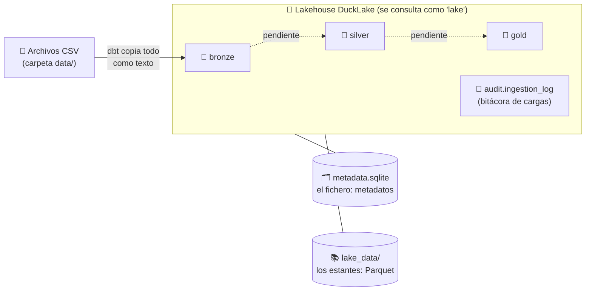

# 🦆 Arquitectura de Datos: un Lakehouse con DuckLake

---

## 1. ¿Qué es este proyecto?

### El caso: los clientes de un supermercado 🛒

Imagina que trabajas en una cadena nacional de supermercados. Cada vez que un cliente pasa por la
caja queda un tiquete de compra, y con millones de tiquetes la empresa quiere entender a sus clientes:
quién compra más, qué compra y si sus campañas de marketing funcionan.

Este proyecto trabaja con datos de esa situación: **The Complete Journey**, un conjunto de datos
publicado por **dunnhumby**, empresa especializada en ciencia de datos del cliente para el comercio
minorista. Contiene:

- **Todas las compras de 2.500 hogares** que compran con frecuencia en un mismo minorista, durante
  **dos años**. No son solo algunas categorías: es la canasta completa. Cada fila equivale a una línea
  del tiquete de compra.
- Para **una parte de los hogares**, información **demográfica**: edad, ingresos, vivienda, niños.
- El **historial de marketing directo**: qué campañas y cupones recibió cada hogar y cuáles usó.
- Qué productos aparecieron en el **folleto semanal** o en **exhibiciones especiales** dentro de la tienda.

Con estos datos se pueden investigar preguntas como las que propone la guía de usuario de dunnhumby:

- ¿Cuántos clientes **gastan más** con el tiempo? ¿Cuántos **gastan menos**? ¿Cómo son esos clientes?
- De los que gastan más, ¿qué **categorías crecen** más rápido?
- De los que gastan menos, ¿de qué categorías se están **alejando**?
- ¿Qué **factores demográficos** influyen en el gasto o en la preferencia por ciertas categorías?
- ¿Hay evidencia de que el **marketing directo** aumente el compromiso de los clientes?

### ¿Qué hace este proyecto con esos datos?

Antes de responder cualquiera de esas preguntas en un tablero de BI, alguien tiene que **reunir los
datos, ordenarlos y dejarlos listos para analizar**. Ese trabajo es la **arquitectura de datos**, y es
lo que construye este proyecto: una arquitectura **completa y en miniatura**, que corre en tu
computador sin servidores ni nube. Con él vas a ver, paso a paso:

1. Cómo llegan los datos crudos: los 8 archivos CSV, tal como los entrega dunnhumby.
2. Cómo se guardan de forma ordenada, versionada y auditable en un *lakehouse*.
3. Cómo se exploran y consultan desde una aplicación web.

### La idea en una imagen: la cocina de un restaurante 🍳

La arquitectura que usamos se llama **medallón** y organiza los datos en tres niveles, como una cocina:

| Nivel | En la cocina | En los datos | Estado en el proyecto |
|---|---|---|---|
| 🥉 **Bronce** | Los ingredientes tal como llegan del proveedor | Copia fiel de los CSV, sin cambiar nada | ✅ Implementado |
| 🥈 **Plata** | Ingredientes lavados, cortados y etiquetados | Datos limpios, con tipos correctos (números, fechas) y sin duplicados | ⏳ Pendiente |
| 🥇 **Oro** | El plato servido al cliente | Tablas listas para el negocio: indicadores y modelos para BI | ⏳ Pendiente |

Nunca se cocina directamente con lo que llega en la caja: primero se guarda tal cual (bronce). Si algo
sale mal después, siempre se puede volver a empezar desde ahí.

---

## 2. Glosario mínimo

| Término | Explicación sencilla |
|---|---|
| **CSV** | Un archivo de texto con una tabla: cada línea es una fila y las columnas se separan con comas. Se abre con Excel. |
| **SQL** | El lenguaje estándar para hacerle preguntas a los datos: *"¿cuánto vendimos por departamento?"*. |
| **Data lake** | Un "depósito" de archivos: barato y flexible, pero desordenado. |
| **Data warehouse** | Una base de datos ordenada en tablas, pensada para análisis. |
| **Lakehouse** | La mezcla de ambos: archivos baratos (lake) que se consultan como tablas ordenadas (warehouse). |
| **Parquet** | Formato de archivo para tablas, comprimido y organizado por columnas. Ocupa mucho menos que un CSV y se lee más rápido. |
| **Metadatos** | "Datos sobre los datos": qué tablas existen, qué columnas tienen, en qué archivos están, qué versiones hay. |
| **Esquema** | Una "carpeta lógica" que agrupa tablas. Aquí hay uno por nivel: `bronze`, `silver`, `gold` y `audit`. |
| **SQLite** | Una base de datos completa guardada en **un solo archivo**, sin servidor. La usan los celulares y los navegadores. Aquí guarda el catálogo del lakehouse. |
| **Snapshot (versión)** | Una "foto" del lakehouse después de cada cambio, como el historial de versiones de un documento en la nube. |
| **Time travel** | Consultar una tabla *tal como estaba* en una versión anterior. |
| **Pipeline** | La secuencia de pasos que mueve y transforma los datos, como una línea de ensamblaje. |

### Las herramientas que usamos

| Herramienta | Qué rol cumple | Analogía |
|---|---|---|
| **DuckDB** | El motor que ejecuta las consultas SQL. Muy rápido y no necesita instalar un servidor. | El bibliotecario |
| **DuckLake** | El formato del lakehouse: guarda los datos en Parquet y los metadatos en un archivo SQLite. | La biblioteca: estantes (Parquet) + fichero (SQLite) |
| **SQLite** | Guarda el **catálogo** de DuckLake: qué tablas existen, sus columnas, sus versiones y qué archivos Parquet las forman. | El fichero de la biblioteca |
| **dbt** | Herramienta para definir las transformaciones como archivos SQL ordenados. | El recetario |
| **Streamlit** | Crea la aplicación web para usar todo desde el navegador. | El mesero que te atiende |
| **uv** | Instala las librerías de Python exactas que necesita el proyecto. | El que surte la despensa |

---

## 3. Los datos: un supermercado real

Usamos el conjunto público **Dunnhumby – The Complete Journey**: las compras de **2.500 hogares**
en una cadena de supermercados durante **2 años** (711 días, 102 semanas), junto con sus campañas de
marketing y cupones.

| Tabla | ¿Qué contiene? (en lenguaje de negocio) | Filas |
|---|---|---:|
| `transaction_data` | Cada producto comprado: hogar, canasta, día, cantidad, valor y descuentos. **Es la tabla principal.** | 2.595.732 |
| `product` | Catálogo: departamento, marca, categoría y tamaño de cada producto. | 92.353 |
| `hh_demographic` | Perfil de los hogares: edad, ingresos, vivienda, número de niños. *(Solo 801 hogares lo reportaron.)* | 801 |
| `campaign_desc` | Las 30 campañas de marketing: tipo y días de inicio y fin. | 30 |
| `campaign_table` | Qué hogares recibieron cada campaña. | 7.208 |
| `coupon` | Qué productos cubre cada cupón de cada campaña. | 124.548 |
| `coupon_redempt` | Qué cupones usó cada hogar y en qué día. | 2.318 |
| `causal_data` | Si un producto estuvo en exhibición o en el folleto, por tienda y semana. | 36.786.524 |

> 💡 **Un detalle de negocio importante:** según la guía de dunnhumby, `SALES_VALUE` es lo que **recibe
> el supermercado**, no necesariamente lo que **pagó el cliente**. Si el cliente usó un cupón del
> fabricante, pagó menos, y el fabricante le reembolsa la diferencia al supermercado. La guía de
> usuario (*The Complete Journey – User Guide*) describe cada columna en detalle.

---

## 4. ¿Cómo está construido? (la arquitectura)



Todo vive en la carpeta `database/`, que se crea sola la primera vez que ejecutas el pipeline:

| Pieza | Dónde está | Qué guarda |
|---|---|---|
| **Fichero (catálogo)** | `database/metadata.sqlite` | Solo metadatos: tablas, columnas, versiones y archivos |
| **Estantes (datos)** | `database/lake_data/<esquema>/<tabla>/*.parquet` | Los datos reales, en Parquet |

Las tablas se nombran siempre como **`lake.<esquema>.<tabla>`**, por ejemplo `lake.bronze.product`.

### ¿Para qué usamos SQLite?

Un lakehouse necesita dos cosas: los **datos** y un **catálogo** que diga qué hay y dónde está. En
este proyecto los datos están en archivos **Parquet** y el catálogo está en **SQLite**, en el archivo
`database/metadata.sqlite`.

Piensa otra vez en la biblioteca: los Parquet son los **libros en los estantes** y SQLite es el
**fichero**. El fichero no contiene los libros, pero sin él nadie sabría qué libros hay, en qué
estante están ni qué edición es la más reciente.

**Qué guarda SQLite (y qué no):**

| Lo que se registra | Tabla dentro de `metadata.sqlite` |
|---|---|
| Los esquemas: `bronze`, `silver`, `gold`, `audit` | `ducklake_schema` |
| Las tablas y sus columnas | `ducklake_table`, `ducklake_column` |
| El historial de versiones y qué cambió en cada una | `ducklake_snapshot`, `ducklake_snapshot_changes` |
| Qué archivos Parquet forman cada tabla y desde qué versión hasta cuál son válidos | `ducklake_data_file` |
| Estadísticas: número de filas y valores mínimos y máximos por columna, para acelerar las consultas | `ducklake_table_stats`, `ducklake_table_column_stats`, `ducklake_file_column_stats` |

**Lo que no guarda son los datos.** El *data inlining* está desactivado, así que todas las filas
quedan en Parquet. Por eso `metadata.sqlite` pesa alrededor de **1 MB**, mientras los Parquet ocupan
cientos de MB.

**Así funciona el *time travel*:** cada archivo Parquet registrado en `ducklake_data_file` tiene una
versión de inicio y una de fin. Para mostrar una tabla "como estaba en la versión 8", DuckLake busca en
SQLite qué archivos estaban vigentes en esa versión y lee solo esos.

**¿Por qué SQLite?** Es un solo archivo, no hay que instalar ni administrar un servidor y se puede
copiar como cualquier documento. La desventaja es que **solo admite un escritor a la vez**: por eso la
app pide no cambiar de pestaña mientras se cargan los datos. En una empresa, el mismo catálogo
podría vivir en una base de datos con servidor, como PostgreSQL, para que muchas personas escriban
al mismo tiempo. DuckLake lo permite sin cambiar los Parquet.

> 🔍 **Míralo tú mismo:** con la app detenida, abre `database/metadata.sqlite` con un visor gratuito
> como [DB Browser for SQLite](https://sqlitebrowser.org/). Busca la tabla `ducklake_snapshot` para
> ver el historial de versiones, o `ducklake_data_file` para ver los Parquet de cada tabla.
> **Solo míralo, no lo modifiques:** si cambias algo, el lakehouse puede dañarse.

### ¿Qué pasa cuando presiono "Iniciar Ejecución"?

1. **El orquestador** (`pipeline/orchestrator.py`) crea un identificador único para la corrida, el
   `batch_id` (ej. `20261014T183000-a1b2c3`).
2. **La capa bronce** (`pipeline/layers/bronze.py`) le pide a **dbt** que ejecute los modelos de
   `models/bronze/`, un archivo `.sql` por tabla.
3. **dbt** lee cada CSV con DuckDB, le añade tres columnas de control y guarda el resultado en el
   lakehouse. DuckLake lo convierte en archivos Parquet y crea una **nueva versión**.
4. **La bitácora** `audit.ingestion_log` registra cada tabla: cuántas filas, cuánto tardó y si salió bien.
5. **La app** te muestra el resultado de cada tabla.

---

## 5. Primeros pasos

### Paso 1 · Requisitos (una sola vez)

- **Python 3.11** o superior.
- **uv**, el instalador de librerías:
  - macOS / Linux: `curl -LsSf https://astral.sh/uv/install.sh | sh`
  - Windows (PowerShell): `powershell -ExecutionPolicy ByPass -c "irm https://astral.sh/uv/install.ps1 | iex"`

### Paso 2 · Instalar las librerías del proyecto

Abre una terminal **dentro de la carpeta del proyecto** y escribe:

```bash
uv sync
```

### Paso 3 · Poner los datos

Copia los 8 archivos CSV en la carpeta `data/` (los nombres deben ser exactamente los de la tabla
de la sección 3, con extensión `.csv`).

### Paso 4 · Abrir la aplicación

```bash
uv run streamlit run app.py
```

Se abrirá el navegador en `http://localhost:8501`. Para cerrar la app, vuelve a la terminal y
presiona `Ctrl + C`.

---

## 6. Recorrido por la aplicación

| Pestaña | Para qué sirve | Qué te invitamos a observar |
|---|---|---|
| ▶️ **Ejecución** | Cargar los datos. Elige la capa (`all` o `bronze`) y, si quieres, solo algunas tablas (ej. `product coupon`). Luego presiona **Iniciar Ejecución**. | Cuánto tarda cada tabla y cuántas filas carga. ¿Por qué `causal_data` tarda más? |
| 🔎 **Explorador** | Ver qué tablas existen, sus columnas y una muestra de los datos. | Todas las columnas son texto (`VARCHAR`). Con **Viaje en el tiempo**, mira cómo estaba una tabla en una versión anterior. |
| 🕰️ **Historial** | Revisar la bitácora de cargas y las versiones del lakehouse. | Cada carga deja rastro: cuándo, cuántas filas y si hubo errores. Es la base de la **gobernanza de datos**. |

> ⚠️ Mientras se ejecuta el pipeline, espera a que termine antes de cambiar de pestaña: la base de
> datos está ocupada escribiendo.

### ¿Prefieres la terminal?

```bash
uv run main.py run                           # carga todas las capas
uv run main.py run --layer bronze            # solo la capa bronce
uv run main.py run --tables product coupon   # solo algunas tablas
uv run main.py info                          # resumen: tablas, tamaño y versiones
```

---

## 7. La capa bronce: reglas y por qué existen

| Regla | Qué significa | ¿Por qué? |
|---|---|---|
| **Fidelidad al origen** | Todas las columnas se guardan como **texto** (`VARCHAR`) y con su nombre original. | Si se convierte a número, un código como `"000123"` se volvería `123` y se perdería información. Convertir tipos es tarea de la capa plata. |
| **Trazabilidad** | Cada fila lleva tres columnas extra: `_batch_id` (qué carga la trajo), `_source_file` (de qué archivo vino) y `_ingested_at` (cuándo llegó). | Para responder siempre *"¿de dónde salió este dato?"*. |
| **Carga completa** | Cada ejecución reemplaza la tabla con el contenido actual del CSV. | Es simple y predecible. La historia no se pierde: queda en las versiones anteriores. |
| **Todo o nada** | La tabla anterior solo se reemplaza si la nueva carga terminó bien. | Nunca queda una tabla a medio cargar. |

---

## 8. Mapa del proyecto

```
Data_Architecture/
├── data/                  📄 Los CSV originales (la materia prima)
├── database/              🦆 El lakehouse (se crea al ejecutar)
├── app.py                 🌐 La aplicación web (Streamlit)
├── main.py                ⌨️ Los comandos de terminal
├── models/                📖 El recetario de dbt
│   ├── sources.yml        ·  Dónde está cada CSV y cómo leerlo
│   └── bronze/*.sql       ·  Una receta por tabla bronce
├── dbt_plugin.py          🔌 Conecta dbt con el lakehouse
├── dbt_project.yml        ⚙️ Configuración de dbt
├── profiles.yml           ⚙️ Conexión de dbt a DuckDB
├── macros/                ⚙️ Ajustes de dbt para DuckLake
└── pipeline/              🏭 El código del pipeline
    ├── config/settings.py ·  Panel de control: rutas, opciones y lista de fuentes
    ├── core/lakehouse.py  ·  Abre la conexión al lakehouse
    ├── core/catalog.py    ·  Consultas de información (tablas, versiones, bitácora)
    ├── core/base.py       ·  El molde que siguen todas las capas
    ├── layers/bronze.py   ·  La capa bronce
    └── orchestrator.py    ·  Decide qué capas se ejecutan y en qué orden
```

> 💡 Los archivos de `pipeline/` tienen comentarios extensos en español que explican cada paso.
> Si quieres entender algo, ábrelos: están escritos para leerse como un tutorial.

### ¿Cómo agrego una tabla nueva?

1. Copia el CSV en `data/`.
2. Declara el archivo en `models/sources.yml` (copia uno de los bloques existentes).
3. Crea `models/bronze/<tabla>.sql` copiando otro modelo y cambiando el nombre de la tabla.
4. Añade una línea `SourceTable(...)` en `pipeline/config/settings.py`.

---

## 9. Problemas frecuentes

| Síntoma | Causa probable | Solución |
|---|---|---|
| `database is locked` | El pipeline está escribiendo mientras otra cosa intenta leer. | Espera a que termine la ejecución y vuelve a intentar. |
| Cambié un archivo y la app se ve igual | Streamlit aún usa la versión anterior. | Recarga la página y elige **Rerun**, o detén la app (`Ctrl + C`) y vuelve a abrirla. |
| Una tabla aparece como `FAILED` | Falta el CSV o tiene otro nombre. | Revisa la carpeta `data/` y el mensaje de error en la app. |
| `No module named 'dbt_plugin'` al usar dbt directamente | dbt no encuentra los archivos del proyecto. | Ejecuta: `PYTHONPATH=. uv run dbt run --select bronze --profiles-dir .` |
| En versiones antiguas veo `batch_id`, `file_name`, `ingested_at` | Son cargas hechas antes de estandarizar las columnas de control. | Es normal; las cargas nuevas usan `_batch_id`, `_source_file` e `_ingested_at`. |

---

## 10. Próximos pasos (retos para el curso)

1. 🥈 **Capa plata:** convertir los textos a sus tipos reales (`INTEGER`, `DECIMAL`), limpiar valores,
   quitar duplicados y estandarizar los nombres de columnas.
2. 🥇 **Capa oro:** construir un **modelo dimensional** (tablas de hechos y dimensiones, por ejemplo
   `fact_ventas`, `dim_producto`, `dim_hogar`) listo para conectar a Power BI o Tableau.
3. Registrar ambas capas en el orquestador (`LAYERS` en `pipeline/orchestrator.py`).

---

<details>
<summary>🔧 <b>Anexo técnico: mantenimiento del lakehouse</b> (opcional)</summary>

DuckLake conserva los Parquet de versiones antiguas para permitir el *time travel*. Con el tiempo
ocupan espacio. Para liberarlo, abre una consola de Python con `uv run python` (con el pipeline detenido) y ejecuta
cada instrucción con `con.sql("...")`, después de `from pipeline.core.lakehouse import get_connection`
y `con = get_connection()`:

```sql
CALL ducklake_expire_snapshots('lake', older_than => now() - INTERVAL 7 DAYS);  -- olvida versiones de más de 7 días
CALL ducklake_cleanup_old_files('lake', cleanup_all => true);                    -- borra sus archivos
CALL ducklake_merge_adjacent_files('lake');                                      -- junta archivos pequeños
```

⚠️ Después de esto ya no podrás viajar en el tiempo a las versiones eliminadas.

El *data inlining* de DuckLake está desactivado (`DATA_INLINING_ROW_LIMIT = 0`): por eso el archivo
SQLite contiene **solo metadatos** y todos los datos quedan en Parquet.

Más detalle sobre el diseño y la instalación en [`SETUP.md`](SETUP.md).

</details>
