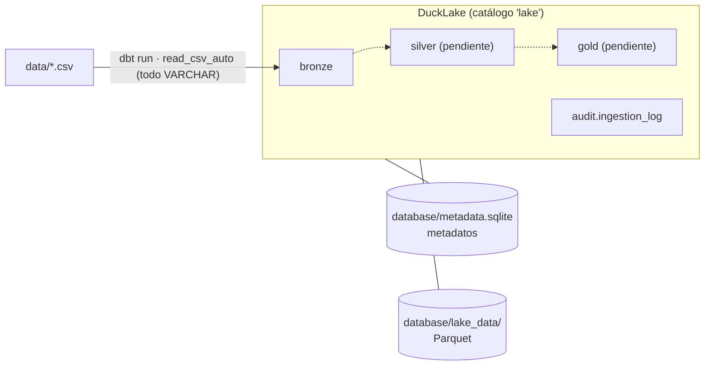

# Data Architecture – Lakehouse con DuckLake

Lakehouse local construido con **[DuckLake](https://ducklake.select/)** sobre **DuckDB**, organizado en una
**arquitectura medallón** (bronce → plata → oro). Por ahora está implementada la **capa bronce**.

## Arquitectura



| Componente | Ubicación | Contenido |
|---|---|---|
| Catálogo (metadatos) | `database/metadata.sqlite` | Esquemas, tablas, columnas, snapshots, estadísticas y archivos (`ducklake_*`) |
| Datos | `database/lake_data/<esquema>/<tabla>/*.parquet` | Archivos Parquet que administra DuckLake |
| Motor | DuckDB (`lake.<esquema>.<tabla>`) | Consulta y escritura |
| Transformaciones | dbt (`models/`) | Un modelo `.sql` por tabla; dbt se conecta a DuckLake con `dbt_plugin.py` |

> El *data inlining* está desactivado (`DATA_INLINING_ROW_LIMIT = 0`), así que el SQLite contiene **solo metadatos**.

## Estructura del proyecto

```
├── data/                     # CSV fuente (Dunnhumby – The Complete Journey)
├── database/                 # Lakehouse (se genera al ejecutar)
├── main.py                   # CLI
├── app.py                    # Interfaz web (Streamlit)
├── dbt_project.yml           # Proyecto dbt
├── profiles.yml              # Conexión dbt -> DuckDB (con dbt_plugin)
├── dbt_plugin.py             # ATTACH de DuckLake dentro de dbt
├── macros/                   # Ajustes de dbt para DuckLake
├── models/
│   ├── sources.yml           # CSV de origen (read_csv_auto, all_varchar)
│   └── bronze/*.sql          # Un modelo por tabla bronce
└── pipeline/
    ├── config/settings.py    # Rutas, opciones DuckLake y registro de fuentes
    ├── core/
    │   ├── base.py           # Contrato Layer + StepResult
    │   ├── catalog.py        # Consultas de metadatos (CLI y app)
    │   └── lakehouse.py      # ATTACH DuckLake (SQLite + Parquet) y esquemas
    ├── layers/
    │   └── bronze.py         # Capa bronce: ejecuta dbt y llena la bitácora
    └── orchestrator.py       # Ejecuta las capas en orden medallón
```

## 💻 Uso

Puedes interactuar con el Lakehouse de dos formas: a través de la interfaz gráfica o desde la terminal.

### 🌐 Interfaz Gráfica (Recomendado)

El proyecto incluye una aplicación web interactiva construida con Streamlit.

1.  **Abre una terminal** en la carpeta del proyecto.
2.  Escribe el siguiente comando:
    ```bash
    uv run streamlit run app.py
    ```
3.  Se abrirá automáticamente una ventana en tu navegador web.
    *   **▶️ Ejecución:** Selecciona la capa que quieres correr (ej. "bronze") y haz clic en "Iniciar Ejecución". Verás una barra de progreso en vivo.
    *   **🔎 Explorador:** Revisa qué tablas hay cargadas, consulta sus columnas y previsualiza los datos reales. Puedes usar el "Viaje en el tiempo" para ver cómo estaban los datos en el pasado.
    *   **🕰️ Historial:** Consulta el tiempo que tardó cada tabla en cargar y el historial de versiones del lakehouse.

### ⌨️ Desde la Terminal (CLI)

Si prefieres la línea de comandos, el archivo `main.py` es el punto de entrada.

```bash
uv run main.py run                           # todas las capas registradas
uv run main.py run --layer bronze            # solo bronce
uv run main.py run --tables product coupon   # solo algunas tablas
uv run main.py info                          # tablas, archivos Parquet y snapshots
```

## Capa bronce

- **Fidelidad al origen:** todas las columnas se cargan como `VARCHAR` y con su **nombre original**.
- **Columnas de auditoría:** `_batch_id`, `_source_file`, `_ingested_at`.
- **Full refresh:** cada ejecución reconstruye la tabla con dbt (`materialized='table'`); la tabla
  anterior solo se reemplaza si la carga terminó bien.
- **Trazabilidad:** cada carga genera un snapshot de DuckLake y una fila en `lake.audit.ingestion_log`.
  El `_batch_id` de las filas es el mismo de la bitácora, así que se pueden cruzar:

  ```sql
  SELECT l.*, count(*) AS filas
  FROM bronze.product p JOIN audit.ingestion_log l ON l.batch_id = p._batch_id AND l.table_name = 'product'
  GROUP BY ALL;
  ```

> Las cargas hechas antes de este ajuste tienen las columnas `batch_id`, `file_name` e `ingested_at`
> (sin guion bajo) y el `batch_id` de dbt; siguen disponibles con *time travel*.

| Tabla bronce | Origen | Filas |
|---|---|---:|
| `campaign_desc` | campaign_desc.csv | 30 |
| `campaign_table` | campaign_table.csv | 7,208 |
| `causal_data` | causal_data.csv | 36,786,524 |
| `coupon` | coupon.csv | 124,548 |
| `coupon_redempt` | coupon_redempt.csv | 2,318 |
| `hh_demographic` | hh_demographic.csv | 801 |
| `product` | product.csv | 92,353 |
| `transaction_data` | transaction_data.csv | 2,595,732 |

Para agregar una fuente nueva:

1. Declárala en `models/sources.yml`.
2. Crea `models/bronze/<tabla>.sql` copiando uno existente y cambiando el nombre.
3. Añade su `SourceTable` en `pipeline/config/settings.py` (lo usan la app y la bitácora).

También puedes ejecutar dbt directamente: `PYTHONPATH=. uv run dbt run --select bronze --profiles-dir .`

## Consultas de ejemplo (DuckDB CLI)

```sql
INSTALL ducklake; INSTALL sqlite;
ATTACH 'ducklake:sqlite:database/metadata.sqlite' AS lake (DATA_PATH 'database/lake_data/');
USE lake;

SELECT * FROM bronze.product LIMIT 5;
SELECT * FROM audit.ingestion_log ORDER BY logged_at DESC;

-- Historial de versiones
SELECT snapshot_id, snapshot_time, commit_message FROM ducklake_snapshots('lake');

-- Time travel: la tabla tal como estaba en un snapshot anterior
SELECT count(*) FROM bronze.product AT (VERSION => 8);
```

## Mantenimiento

Los Parquet de versiones antiguas se conservan para el *time travel*. Para liberar espacio:

```sql
CALL ducklake_expire_snapshots('lake', older_than => now() - INTERVAL 7 DAYS);
CALL ducklake_cleanup_old_files('lake', cleanup_all => true);
CALL ducklake_merge_adjacent_files('lake');  -- compacta archivos pequeños (p. ej. ingestion_log)
```

## Próximos pasos

1. `pipeline/layers/silver.py`: tipado, limpieza, deduplicación y nombres estandarizados.
2. `pipeline/layers/gold.py`: modelo dimensional (hechos/dimensiones) para BI.
3. Registrar ambas capas en `LAYERS` (`pipeline/orchestrator.py`).
