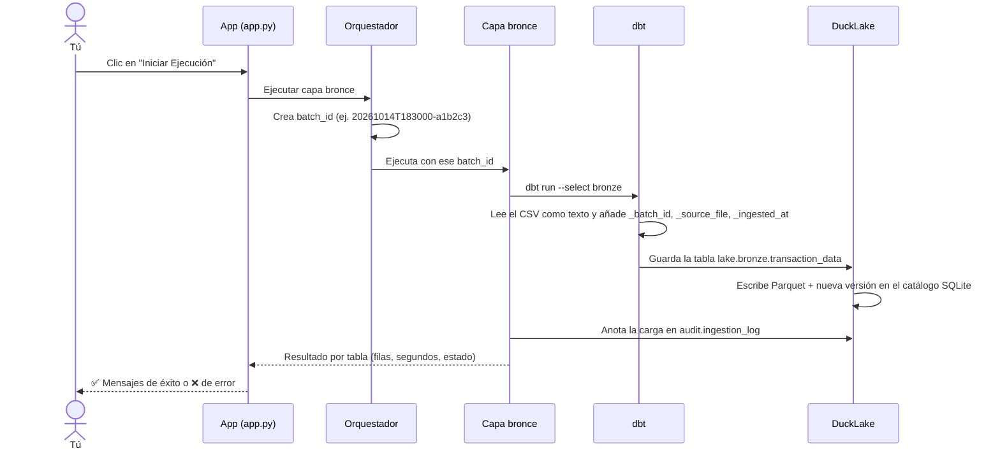

# 🛠️ Guía de instalación y funcionamiento interno

> **¿Qué encuentras aquí?** El [`README.md`](README.md) explica *qué es* el proyecto y *cómo usarlo*.
> Esta guía explica **cómo instalarlo desde cero** en tu computador, **qué pasa por dentro** y
> **por qué se diseñó así**. Está escrita para personas que no son expertas en ingeniería de datos.

---

## 1. Antes de empezar: lista de verificación

Marca cada punto antes de pasar a la instalación:

- [ ] Tengo un computador con **Windows, macOS o Linux**.
- [ ] Tengo **conexión a internet** (solo la primera vez, para descargar librerías y extensiones).
- [ ] Tengo al menos **3 GB libres** en disco: los CSV pesan unos 850 MB y el lakehouse ocupa otro tanto.
- [ ] Tengo los **8 archivos CSV** del conjunto *Dunnhumby – The Complete Journey*.
- [ ] Sé abrir una **terminal** (ver recuadro).

> 💡 **¿Qué es una terminal y cómo la abro en la carpeta del proyecto?**
> Es una ventana donde se escriben comandos en lugar de hacer clic.
> - **Windows:** abre la carpeta del proyecto en el Explorador, escribe `powershell` en la barra de
>   direcciones y presiona Enter.
> - **macOS:** clic derecho sobre la carpeta → *Servicios* → *Nueva terminal en la carpeta*.
> - **Linux:** clic derecho dentro de la carpeta → *Abrir en una terminal*.
>
> También puedes abrir la carpeta en **VS Code** y usar *Terminal → New Terminal*.

---

## 2. Instalación paso a paso

Cada paso termina con un **✅ Cómo sé que funcionó**. Si algo no coincide, mira la
[sección 6](#6-solución-de-problemas-de-instalación).

### Paso 1 · Instalar `uv` (el instalador de librerías)

`uv` descarga e instala Python y todas las librerías que necesita el proyecto, **en las versiones
exactas** con que se construyó. Así el proyecto funciona igual en todos los computadores del curso.

| Sistema | Comando |
|---|---|
| macOS / Linux | `curl -LsSf https://astral.sh/uv/install.sh \| sh` |
| Windows (PowerShell) | `powershell -ExecutionPolicy ByPass -c "irm https://astral.sh/uv/install.ps1 \| iex"` |

**Cierra la terminal y ábrela de nuevo** para que reconozca el nuevo comando.

✅ **Cómo sé que funcionó:** al escribir `uv --version` aparece un número de versión.

### Paso 2 · Instalar las librerías del proyecto

En la terminal, **dentro de la carpeta del proyecto**, escribe:

```bash
uv sync
```

Esto lee dos archivos:

- `pyproject.toml`: la "lista de compras", es decir, qué librerías necesita el proyecto (DuckDB, dbt,
  Streamlit).
- `uv.lock`: la "factura detallada", con la versión exacta de cada librería y de sus dependencias.

Con ellos crea una carpeta oculta `.venv/` (el *entorno virtual*), donde quedan instaladas las
librerías **solo para este proyecto**, sin afectar el resto del computador. Si hace falta, `uv`
también descarga Python 3.11.

✅ **Cómo sé que funcionó:** el comando termina sin errores rojos y aparece la carpeta `.venv/`.

### Paso 3 · Poner los datos en su lugar

Crea (si no existe) una carpeta llamada `data` dentro del proyecto y copia allí los 8 archivos:

```
data/
├── campaign_desc.csv
├── campaign_table.csv
├── causal_data.csv        ← el más grande (~700 MB)
├── coupon.csv
├── coupon_redempt.csv
├── hh_demographic.csv
├── product.csv
└── transaction_data.csv
```

Los nombres deben coincidir **exactamente**, en minúsculas. Si falta un archivo, su tabla aparecerá
como `FAILED`, pero las demás se cargan normalmente.

✅ **Cómo sé que funcionó:** la carpeta `data/` contiene los 8 archivos.

### Paso 4 · Primera carga de datos

Recomendamos hacer la primera carga desde la terminal, porque ahí se ven todos los mensajes:

```bash
uv run main.py run
```

La primera vez, DuckDB descarga dos **extensiones** (complementos): `ducklake` y `sqlite`. Luego
dbt carga las 8 tablas. Según el computador puede tardar desde unos segundos hasta algunos minutos.

✅ **Cómo sé que funcionó:** al final aparece un resumen parecido a este:

```
=== Resumen ===
bronze  campaign_desc      SUCCESS              30 filas     0.1s
bronze  causal_data        SUCCESS      36,786,524 filas     2.2s
...
Total: 8 tabla(s), 0 fallida(s), 6.3s
```

Y aparece la carpeta `database/` con el lakehouse. Para ver su contenido:

```bash
uv run main.py info
```

### Paso 5 · Abrir la aplicación web

```bash
uv run streamlit run app.py
```

✅ **Cómo sé que funcionó:** el navegador abre `http://localhost:8501` con el menú
*Arquitectura de Datos: Ducklake*. En **🔎 Explorador** deberías ver las 8 tablas de bronce.

Para cerrar la aplicación, vuelve a la terminal y presiona `Ctrl + C`.

🎉 **¡Listo!** Continúa con el recorrido de la aplicación y los ejercicios del [`README.md`](README.md).

---

## 3. ¿Qué pasa por dentro? El viaje de un dato

Sigamos una sola fila, una compra de leche del archivo `transaction_data.csv`, desde el CSV hasta la
pantalla:



**Quién hace cada cosa:**

| Paso | Archivo responsable | En palabras simples |
|---|---|---|
| Recibir la orden | `app.py` o `main.py` | La "puerta de entrada": la web o la terminal |
| Organizar la corrida | `pipeline/orchestrator.py` | El director de orquesta: decide qué capas se ejecutan y en qué orden |
| Cargar bronce | `pipeline/layers/bronze.py` | Le pide a dbt que trabaje y luego anota el resultado en la bitácora |
| Saber dónde está cada CSV | `models/sources.yml` | El directorio de proveedores |
| Definir cada tabla | `models/bronze/*.sql` | Una receta SQL por tabla |
| Conectar dbt al lakehouse | `dbt_plugin.py` + `profiles.yml` | Le entrega a dbt "las llaves" de la biblioteca |
| Abrir el lakehouse | `pipeline/core/lakehouse.py` | Abre DuckDB y conecta el catálogo (SQLite) con los datos (Parquet) |
| Consultar información | `pipeline/core/catalog.py` | Responde "¿qué tablas hay?", "¿qué versiones existen?" |
| Configuración general | `pipeline/config/settings.py` | El panel de control: rutas, nombres y lista de fuentes |

---

## 4. Decisiones de diseño: ¿por qué así?

Toda arquitectura es un conjunto de decisiones. Estas son las principales, con sus ventajas y lo
que se sacrifica: un buen ejercicio de discusión para la clase.

| Decisión | ¿Por qué? | ¿Qué se sacrifica? |
|---|---|---|
| **Todo local, sin nube** | Cero costo, cero cuentas, funciona sin conexión después de instalar. | No escala a muchos usuarios ni a terabytes de datos. |
| **DuckDB como motor** | Analiza millones de filas en segundos en un portátil y no requiere un servidor. | Está pensado para un solo usuario a la vez. |
| **DuckLake como formato** | Ofrece versiones, *time travel* y transacciones sobre archivos Parquet abiertos. | Es una tecnología reciente y con menos herramientas a su alrededor. |
| **Catálogo en SQLite** | Es un solo archivo, sin instalar nada. | Solo admite un escritor a la vez: por eso la app bloquea las otras pestañas mientras carga. |
| **Sin *data inlining*** | Separa por completo los datos (Parquet) de los metadatos (SQLite), lo que es más fácil de explicar y de inspeccionar. | Las tablas muy pequeñas generan archivos Parquet diminutos. |
| **Bronce todo en texto** | No se pierde información (ej. el código `"000123"` no se convierte en `123`) y la carga nunca falla por un tipo mal inferido. | Para analizar hay que convertir tipos: es el trabajo de la capa plata. |
| **Carga completa** | Es simple y predecible: la tabla siempre refleja el CSV actual. | Recarga todo aunque haya cambiado poco. Con fuentes enormes se usaría carga incremental. |
| **dbt para las transformaciones** | Cada tabla es un archivo SQL legible y versionable; es el estándar de la industria. | Agrega una herramienta más que aprender. |
| **Streamlit para la interfaz** | Crea una app web con pocas líneas de Python. | No está pensada para aplicaciones grandes con muchos usuarios. |
| **`uv` + `uv.lock`** | Reproducibilidad: todos instalan exactamente las mismas versiones. | Requiere instalar `uv`. |
| **Un mismo `batch_id` en filas y bitácora** | Permite rastrear cada fila hasta la carga que la trajo (linaje de datos). | Añade tres columnas a cada tabla. |

---

## 5. ¿Qué archivos se generan y cuáles puedo borrar?

| Carpeta | ¿Qué es? | ¿Puedo borrarla? |
|---|---|---|
| `.venv/` | Librerías instaladas | Sí. Se recrea con `uv sync`. |
| `database/` | **El lakehouse completo**: datos, versiones y bitácora | Sí, para **empezar de cero**. Se recrea con `uv run main.py run`, pero **pierdes todo el historial de versiones**. |
| `target/` | Archivos de trabajo de dbt (SQL compilado y resultados) | Sí. Se recrea en la siguiente ejecución. |
| `logs/` | Registro detallado de dbt (`dbt.log`) | Sí. Útil para diagnosticar errores. |
| `data/` | Los CSV originales | **No**, a menos que tengas copia: son la fuente de todo. |

Estas carpetas están excluidas de Git (`.gitignore`) porque son pesadas o se regeneran. Por eso, al
clonar el repositorio, hay que conseguir los CSV por aparte (Paso 3).

---

## 6. Solución de problemas de instalación

| Síntoma | Causa probable | Solución |
|---|---|---|
| `uv: command not found` / *"uv no se reconoce"* | La terminal se abrió antes de instalar `uv`. | Cierra y vuelve a abrir la terminal. Si persiste, reinstala `uv` (Paso 1). |
| `uv sync` falla descargando paquetes | Sin internet, o una red (proxy) que bloquea descargas. | Prueba con otra red. En redes corporativas o universitarias, consulta a soporte. |
| Error al descargar `ducklake` o `sqlite` en la primera carga | DuckDB descarga sus extensiones de internet la primera vez. | Conéctate a internet y repite el Paso 4. Después ya no hace falta conexión. |
| Todas las tablas salen `FAILED` | Se ejecutó fuera de la carpeta del proyecto, o falta `data/`. | Verifica con `ls` (macOS/Linux) o `dir` (Windows) que estás en la carpeta correcta. |
| `database is locked` | Dos procesos usan el lakehouse a la vez (ej. la app cargando y una consulta en la terminal). | Espera a que termine la carga o cierra el otro proceso. |
| `Port 8501 is already in use` | La app ya está abierta en otra terminal. | Ciérrala con `Ctrl + C`, o usa otro puerto: `uv run streamlit run app.py --server.port 8502`. |
| `No module named 'dbt_plugin'` al usar dbt directamente | dbt no encuentra los archivos del proyecto. | macOS/Linux: `PYTHONPATH=. uv run dbt run --select bronze --profiles-dir .` · Windows (PowerShell): primero `$env:PYTHONPATH="."` y luego `uv run dbt run --select bronze --profiles-dir .` |
| El computador se pone lento durante la carga | `causal_data` tiene casi 37 millones de filas. | Es normal. Cierra otros programas, o carga primero solo tablas pequeñas: `uv run main.py run --tables product coupon`. |

---

## 7. Para ir más allá: construir las capas plata y oro

La estructura ya está preparada para crecer. Una ruta sugerida:

1. **Crear los modelos dbt** en `models/silver/` y `models/gold/`. En lugar de leer los CSV, cada
   modelo lee la capa anterior con `{{ ref('nombre_del_modelo') }}`. Así dbt sabe en qué orden ejecutarlos.
2. **Plata:** convertir tipos (`CAST(SALES_VALUE AS DECIMAL(10,2))`), limpiar textos (`trim`,
   `lower`), quitar duplicados y poner nombres de columna claros (`household_key` → `id_hogar`).
3. **Oro:** armar el **modelo dimensional** (por ejemplo `fact_ventas`, `dim_producto`, `dim_hogar`,
   `dim_tiempo`), que es lo que se conecta a Power BI o Tableau.
4. **Configurar el destino** en `dbt_project.yml` (esquema `silver` / `gold`, como ya está hecho para bronce).
5. **Registrar las capas** en el orquestador: crear `pipeline/layers/silver.py` siguiendo el ejemplo de
   `bronze.py` y añadirlo al diccionario `LAYERS` de `pipeline/orchestrator.py`. La app las mostrará
   automáticamente en el selector de capas.
